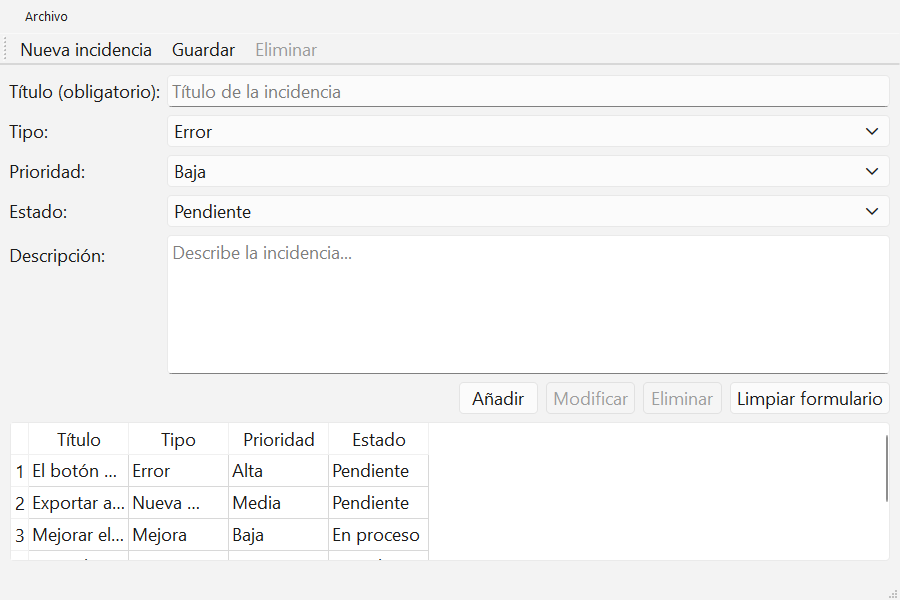
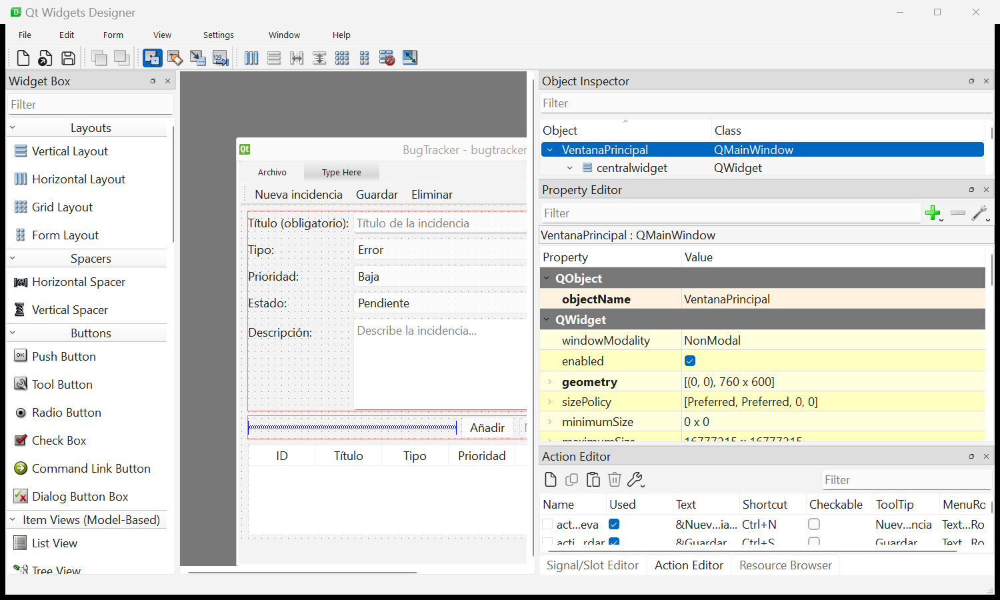
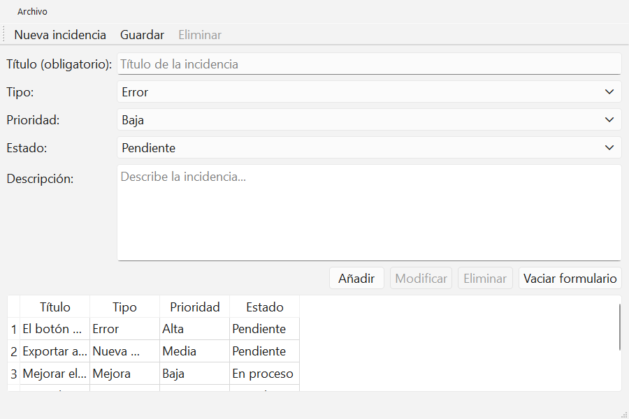

# DI · Cambiar la interfaz en Qt Designer y verlo en la aplicación

La aplicación no lee el archivo de Designer (`bugtracker.ui`): lee el código Python que se genera a partir de él (`ui_bugtracker.py`). Por eso, después de cambiar algo en Designer hay que **guardar, regenerar el código y volver a lanzar la aplicación**. Esta guía lo hace paso a paso con un ejemplo: cambiar el texto del botón **Limpiar formulario** por **Vaciar formulario**. En las capturas el botón se llama «Limpiar formulario»; en tu proyecto puede llamarse «Limpiar» o «&Limpiar». Se hace igual: cambia su `text` por el que quieras. El paso de `bugtracker.ui` a `ui_bugtracker.py` se explica en [UD2, apartado 2](../../apuntes/UD2-pyside6-y-qt-designer.md#2-del-diseño-al-código).

Todas las órdenes se escriben en **PowerShell**, en la carpeta del proyecto. En el ejemplo, la carpeta es `C:\dam\di\bugtracker`, y la terminal muestra:

```
PS C:\dam\di\bugtracker>
```

Si la terminal está en otra carpeta, entra en la del proyecto con `cd` (en el ejemplo, `cd C:\dam\di\bugtracker`).

## 1. Arranca la aplicación tal como está

```
.venv\Scripts\python main.py
```

Se abre el BugTracker. Fíjate en el botón **Limpiar formulario**, abajo a la derecha:



Cierra la ventana. La terminal vuelve a `PS C:\dam\di\bugtracker>`.

## 2. Abre Qt Designer

```
Start-Process .venv\Scripts\pyside6-designer.exe -ArgumentList bugtracker.ui -WindowStyle Hidden
```

- `Start-Process` lo abre aparte, así la terminal queda libre para los pasos siguientes.
- `-WindowStyle Hidden` oculta la ventana de terminal vacía que, sin esta opción, se abre junto a Designer.

Se abre Designer con la ventana del BugTracker en el centro:



- En el centro, la ventana que estás diseñando.
- A la derecha, arriba, el **Object Inspector**: todos los widgets por su `objectName`.
- A la derecha, en medio, el **Property Editor**: las propiedades del widget seleccionado.

## 3. Modifica en Designer

1. En la ventana del centro, haz clic en el botón **Limpiar formulario**. En el **Object Inspector** queda seleccionado `btnLimpiar`.
2. En el **Property Editor**, busca la propiedad `text` (en el filtro de arriba puedes escribir `text`).
3. Haz clic en su valor, cámbialo a `&Vaciar formulario` y pulsa Intro. El `&` hace que la `V` sea el atajo `Alt+V`.
4. Guarda con `Ctrl+S`. El `*` del título de Designer desaparece: el cambio ya está en `bugtracker.ui`.

Deja Designer abierto.

## 4. Regenera el código

Vuelve a la terminal:

```
.venv\Scripts\pyside6-uic bugtracker.ui -o ui_bugtracker.py
```

Si va bien, no muestra nada. Para comprobar que el archivo se ha actualizado, mira la hora de `LastWriteTime`:

```
dir ui_bugtracker.py
```

**Si te saltas este paso**, la aplicación sigue igual aunque hayas guardado en Designer. Esto es lo que se ve sin regenerar:


## 5. Prueba

```
.venv\Scripts\python main.py
```

El botón ya dice **Vaciar formulario**:



Cierra la ventana al acabar.

## Cada vez que cambies algo: pasos 3, 4 y 5

| Paso | Dónde | Qué |
|---|---|---|
| 3 | Designer | Cambiar y `Ctrl+S` |
| 4 | Terminal | `.venv\Scripts\pyside6-uic bugtracker.ui -o ui_bugtracker.py` |
| 5 | Terminal | `.venv\Scripts\python main.py` y cerrar la ventana al acabar |

En la terminal, la flecha ↑ recupera las órdenes anteriores: no hace falta escribirlas otra vez.

Para seguir con el proyecto, deja el botón como pide el paso 2: vuelve a poner `&Limpiar` en Designer, guarda y regenera.

## Si no ves el cambio

| Qué pasa | Por qué | Qué hacer |
|---|---|---|
| El título de Designer tiene un `*` | No has guardado | `Ctrl+S` en Designer |
| `dir ui_bugtracker.py` muestra una hora antigua | No has regenerado, o lo hiciste en otra carpeta | Comprueba que la terminal está en la carpeta del proyecto y repite el paso 4 |
| La aplicación seguía abierta | No se recarga sola | Ciérrala y vuelve a lanzarla (paso 5) |
| Cambiaste algo escribiendo en `ui_bugtracker.py` | Se sobrescribe cada vez que regeneras | Los cambios de la interfaz se hacen siempre en Designer |
| `AttributeError: 'Ui_VentanaPrincipal' object has no attribute ...` | Cambiaste el `objectName` de un widget y `main.py` sigue usando el nombre antiguo | Pon el mismo nombre en `main.py` |
| Junto a Designer se abre una terminal vacía | Falta `-WindowStyle Hidden` en el paso 2 | Cierra Designer y esa terminal, y vuelve a abrirlo con la orden completa del paso 2 |
